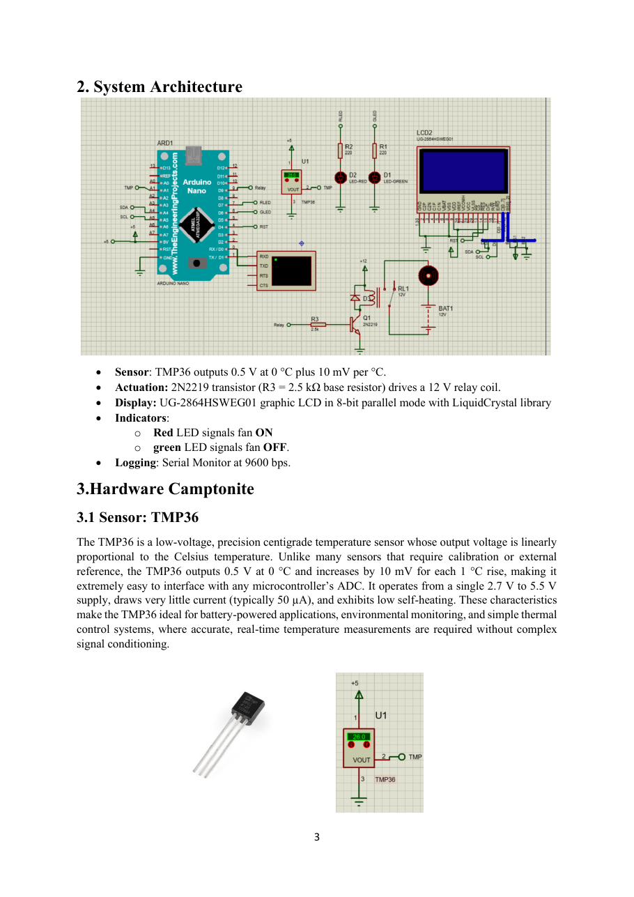
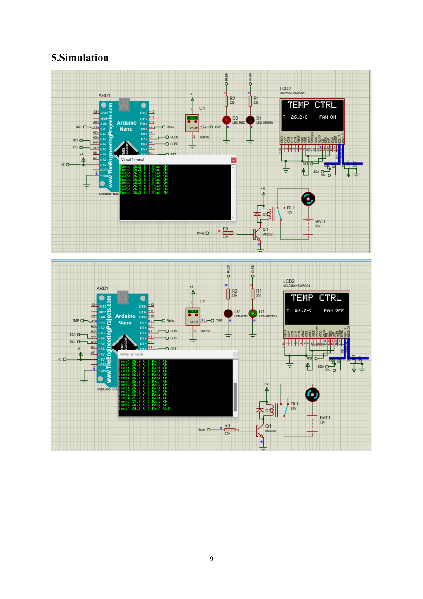
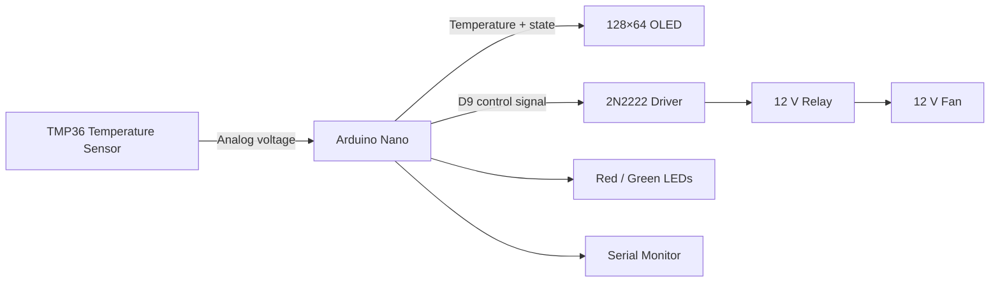

# Arduino Temperature-Controlled Fan System

<p align="center">
  <strong>An embedded control project that automatically switches a 12 V fan from real-time temperature measurements.</strong>
</p>

<p align="center">
  
  
  
  
</p>

<p align="center">
  
</p>

## Portfolio summary

Designed and simulated an automatic fan controller using an Arduino Nano and TMP36 temperature sensor. The controller samples the analog sensor output, converts it to degrees Celsius, and energizes a transistor-driven 12 V relay when the temperature reaches a configurable threshold. A 128×64 OLED display, status LEDs, and serial output provide real-time feedback.

**Course:** Digital Control Laboratory<br>
**Institution:** Islamic University of Gaza — Electrical Engineering Department<br>
**Author:** Yahya Al-Afifi

## Highlights

- Automatic on/off fan control at a **25 °C** threshold
- TMP36 analog sensing and ADC-to-temperature conversion
- 2N2222 transistor driver with flyback diode for the relay coil
- 128×64 OLED interface showing temperature and fan state
- Red/green LED status indication
- Proteus simulation with serial-monitor validation

## Demonstration

[Watch the recorded project demonstration](https://drive.google.com/file/d/10WR0gAPOkZGK9XrWhAyRwASQVme1840T/view?usp=sharing)

<p align="center">
  
</p>

## System architecture



## Hardware

| Component | Role |
| --- | --- |
| Arduino Nano | Reads the sensor and executes the control logic |
| TMP36 | Provides an analog temperature signal |
| 128×64 OLED | Displays temperature and fan status |
| 2N2222 transistor + flyback diode | Safely drives the relay coil |
| 12 V relay and fan | Switches the controlled load |
| Red and green LEDs | Indicate fan ON and OFF states |

| Signal | Arduino pin |
| --- | --- |
| TMP36 output | `A1` |
| Relay driver | `D9` |
| Red LED — fan ON | `D7` |
| Green LED — fan OFF | `D6` |
| OLED | Parallel display interface as defined in the sketch |

See [docs/HARDWARE.md](docs/HARDWARE.md) for the full wiring and safety notes.

## Control logic

```text
Read TMP36 → convert ADC value to °C → compare with 25 °C threshold
  ├─ Temperature ≥ threshold → relay ON, fan ON, red LED ON
  └─ Temperature < threshold → relay OFF, fan OFF, green LED ON
```

## Results

| Temperature | Observed state |
| --- | --- |
| Below 25 °C | Relay OFF, fan OFF, green LED ON |
| At or above 25 °C | Relay ON, fan ON, red LED ON |

## Repository layout

```text
.
├── firmware/temperature_control/    Arduino Nano firmware
├── hardware/proteus/                Proteus simulation project
├── docs/assets/                     Architecture and simulation images
├── docs/report/                     Original academic report
├── docs/HARDWARE.md                 Wiring, component, and safety notes
├── platformio.ini                   PlatformIO build configuration
└── README.md
```

## Build and simulation

### Arduino firmware

1. Open `firmware/temperature_control/temperature_control.ino` in Arduino IDE, or use PlatformIO.
2. Install **Adafruit GFX** and **Adafruit SSD1306**.
3. Select **Arduino Nano (ATmega328P)** and upload the sketch.
4. Adjust `TEMP_THRESHOLD` in the sketch when a different switching point is required.

```bash
pio run
pio run --target upload
```

### Proteus

Open `hardware/proteus/Temperature-Controlled-Fan.pdsprj` in Proteus Design Suite, load the compiled firmware if required by the simulation setup, and run the test cases listed above.

## Notes

This is an academic prototype. Verify current ratings, relay contact ratings, transistor biasing, flyback protection, and supply isolation before connecting a real fan or any mains-powered load.

